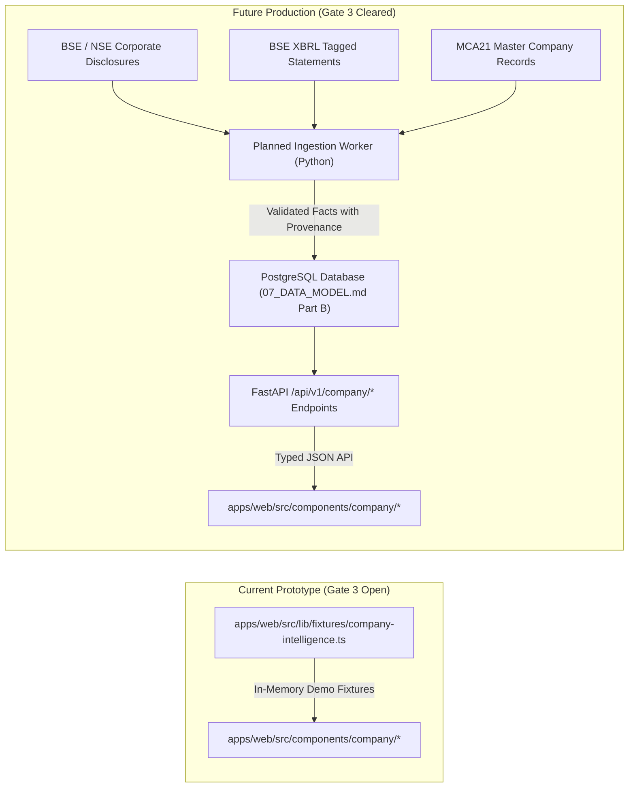

# ZoneScan — Company Intelligence Technical Reference & Implementation Guide

**Document Version:** 1.0.0  
**Status:** Complete Implementation Reference & Architecture Audit  
**Author / Reviewer:** ZoneScan Core Team  
**Date:** 2026-10-30  
**Context & Guardrails:** Adheres to [AGENTS.md](file:///d:/PROJECTS/A%20ZoneScan/ZoneScan/AGENTS.md), [00_PROJECT_BRIEF.md](file:///d:/PROJECTS/A%20ZoneScan/ZoneScan/docs/00_PROJECT_BRIEF.md), [19_FINANCIAL_INTELLIGENCE.md](file:///d:/PROJECTS/A%20ZoneScan/ZoneScan/docs/19_FINANCIAL_INTELLIGENCE.md), [14_DESIGN_SYSTEM.md](file:///d:/PROJECTS/A%20ZoneScan/ZoneScan/docs/14_DESIGN_SYSTEM.md), and [20_REAL_DATA_PILOT_SPEC.md](file:///d:/PROJECTS/A%20ZoneScan/ZoneScan/docs/20_REAL_DATA_PILOT_SPEC.md).

---

## Executive Summary

This document is the definitive, code-verified technical reference for the **Company Intelligence** module in ZoneScan. It provides an exhaustive breakdown of the frontend architecture, component tree, state and data flows, typed fixtures, mathematical models, Cytoscape graph visualizer, integrity audits, and real-data readiness pathways.

> [!IMPORTANT]
> **GATE 3 & PROVENANCE BOUNDARY:**  
> The current Company Intelligence implementation runs entirely on **frontend synthetic demo fixtures** (`isSynthetic: true`, `origin: "synthetic_demo"`). All company identities, financial line items, customer/supplier relationships, and regulatory filings are fictional models constructed to evaluate terminal UI/UX, progressive disclosure ergonomics, and mathematical shock calculators. No live exchange data or private corporate records are contained herein. In accordance with [AGENTS.md](file:///d:/PROJECTS/A%20ZoneScan/ZoneScan/AGENTS.md) and [11_ROADMAP.md](file:///d:/PROJECTS/A%20ZoneScan/ZoneScan/docs/11_ROADMAP.md) (Gate 3), live market scraping and production database scaffolding remain blocked until formal legal licensing review is complete.

---

## 1. Architecture, Component Hierarchy & Data Flow

### 1.1 Application Entry Point & Workspace Routing

ZoneScan uses Next.js 16 (App Router) with React 19. The web application's root view orchestrator resides in [apps/web/src/app/page.tsx](file:///d:/PROJECTS/A%20ZoneScan/ZoneScan/apps/web/src/app/page.tsx).

The workspace routing is controlled via a local state union:
```typescript
type View = "board" | "stock" | "xray" | "company";
```

- When `view === "company"`, the top-level page renders `<CompanyIntelligence onNavigateToBoard={() => setView("board")} />`.
- Workspace navigation is available through:
  1. **Primary Desktop Sidebar:** An interactive navigation button with glyph `☊` and label `Company Intelligence`.
  2. **Mobile Sticky Bottom Nav:** An accessible tab button with glyph `☊` and label `Company`.
  3. **Direct Watchlist Jump:** A callout link (`Company Intelligence Prototype →`) placed inside the Market Board header.
  4. **Stock Detail Bridge:** A direct inspection button on instrument analytics views.
  5. **Top Breadcrumb:** Dynamic workspace path indicator displaying `Workspace / Company Intelligence`.

### 1.2 Component Hierarchy Tree

The Company Intelligence module is organized hierarchically with clean separation between workspace layout, view-specific subcomponents, and global modal progressive disclosure:

```mermaid
graph TD
    Page["apps/web/src/app/page.tsx (view === 'company')"]
    CI["CompanyIntelligence.tsx (Master Workspace Container)"]
    Page --> CI

    subgraph "Header & Shell"
        Banner["Top Synthetic Banner (role='status')"]
        HeaderCard["Company Header Card (Identity, CIN, ISIN)"]
        Switcher["Quick Demo Switcher (select)"]
        MetaBar["Company Attributes Bar (Sector, Valuation, P/E, P/B)"]
        PlainDesc["Plain-Language Business Profile & Exposure Note"]
        TabsNav["Workspace Navigation Tabs (5 Tabs)"]
        CI --> Banner
        CI --> HeaderCard
        HeaderCard --> Switcher
        HeaderCard --> MetaBar
        HeaderCard --> PlainDesc
        CI --> TabsNav
    end

    subgraph "Tab 1: Overview & KPIs"
        KPIGrid["KPI Cards Grid"]
        KPICard["KPICard.tsx (8 Metrics)"]
        SegChart["SegmentChart.tsx (Division Breakdown)"]
        ShareBar["ShareholdingBar.tsx (Ownership Distribution)"]
        KPIGrid --> KPICard
    end

    subgraph "Tab 2: Financial Statements"
        Sparklines["MetricSparkline.tsx (Gross, EBITDA, PAT 3-Yr Trends)"]
        FinTable["FinancialTable.tsx (Multi-Period Income & Balance Sheet)"]
    end

    subgraph "Tab 3: Relationship Graph"
        RelMap["RelationshipMap.tsx (Cytoscape.js Concentric Visualizer)"]
        CyViewport["HTML5 Canvas Cytoscape Viewport"]
        NodeDrawer["Node Inspector Article Drawer"]
        AdjacencyTable["Accessible Adjacency Table Fallback"]
        RelMap --> CyViewport
        RelMap --> NodeDrawer
        RelMap --> AdjacencyTable
    end

    subgraph "Tab 4: Supply Chain & Commodities"
        SCSim["SupplyChainSimulator.tsx (Scenario Stress Tester)"]
        MatCards["Raw Material Dependency Cards"]
        Slider["Terminal Range Slider (-20% to +30%)"]
        ImpactGrid["Cost Delta & Margin Compression Display"]
        Disruptions["Supply Chain Disruption & Freight Signals"]
        SCSim --> MatCards
        SCSim --> Slider
        SCSim --> ImpactGrid
        SCSim --> Disruptions
    end

    subgraph "Tab 5: Filings & Disclosures"
        FilingList["FilingList.tsx (Statutory Announcement Stream)"]
        FilingCard["Regulatory Filing Cards (Reg 30, Reg 31, Results)"]
        FilingList --> FilingCard
    end

    subgraph "Shared Elements & Level 3 Progressive Disclosure"
        EB["EvidenceBadge.tsx (Disclosed/Verified/Inferred/Unconfirmed)"]
        SP["SourcePanel.tsx (Slide-Over Drawer / Level 3 Audit Trail)"]
    end

    CI --> KPIGrid
    CI --> SegChart
    CI --> ShareBar
    CI --> Sparklines
    CI --> FinTable
    CI --> RelMap
    CI --> SCSim
    CI --> FilingList
    CI --> SP

    KPICard -.-> EB
    FinTable -.-> EB
    RelMap -.-> EB
    SCSim -.-> EB
    FilingCard -.-> EB
    SP -.-> EB
```



### 1.3 State Management & Data Flow

The workspace maintains three core reactive state variables inside [CompanyIntelligence.tsx](file:///d:/PROJECTS/A%20ZoneScan/ZoneScan/apps/web/src/components/company/CompanyIntelligence.tsx):

1. `selectedCompanyId: string` (Defaults to `"zenith-fab"`): Controls which company object is selected from `DEMO_COMPANIES`.
2. `activeTab: CompanyTab` (`"overview" | "financials" | "relationships" | "supply_chain" | "filings"`): Dictates which panel is rendered in the main workspace body.
3. `inspectingEvidenceId: string | null` (Defaults to `null`): When set to an evidence ID string (e.g., `"ev-zenith-gross-margin"`), it opens the global Level 3 `SourcePanel` slide-over drawer.

#### Progressive Disclosure Architecture (3 Levels)

- **Level 1 (Glance / Summary):** Headline numbers on `KPICard`, visual bars on `SegmentChart` and `ShareholdingBar`, network nodes on `RelationshipMap`, and high-level filing pills.
- **Level 2 (Structured Detail):** Multi-period income statement and balance sheet schedules in `FinancialTable`, trend sparklines with hover coordinates in `MetricSparkline`, scenario sliders in `SupplyChainSimulator`, and node detail side-panels in `RelationshipMap`.
- **Level 3 (Audit Trail & Verification):** Triggered by clicking any `EvidenceBadge` or "Inspect source ↗" link. Opens `SourcePanel.tsx`, displaying the exact mathematical formula, document citation, section/note number, filing date, verbatim excerpt, and independent verification scenario.

---

## 2. Company Fixtures & Source of Truth

The single source of truth for all Company Intelligence demo data is [apps/web/src/lib/fixtures/company-intelligence.ts](file:///d:/PROJECTS/A%20ZoneScan/ZoneScan/apps/web/src/lib/fixtures/company-intelligence.ts) (1,119 lines, 63,562 bytes).

### 2.1 Fictional Corporate Entities

Two contrasting manufacturing companies are implemented to test different operational structures, margins, and supply chain dependencies:

| Attribute | Company 1: Zenith Precision Fabrications Ltd | Company 2: Apex Ferrous & Superalloys Ltd |
|---|---|---|
| **ID** | `zenith-fab` | `apex-alloys` |
| **Stock Symbol** | `ZENITHFAB` | `APEXALLOY` |
| **Exchange** | `NSE (Synthetic Demo Fixture)` | `NSE (Synthetic Demo Fixture)` |
| **Fictional CIN** | `SYN-L28910MH2012PLC987654 (Demo)` | `SYN-L27100GJ2008PLC876543 (Demo)` |
| **Fictional ISIN** | `SYN-INE999X01099 (Demo)` | `SYN-INE888Y01088 (Demo)` |
| **Sector / Industry** | Capital Goods & Engineering / Industrial Machinery | Metals & Mining / Specialty Steel & Forging Billets |
| **Incorporated / HQ** | 2012 / Pune, Maharashtra | 2008 / Ahmedabad, Gujarat |
| **Market Capitalization** | ₹4,896.00 Cr | ₹2,178.00 Cr |
| **Enterprise Value (EV)** | ₹4,937.50 Cr | ₹2,383.00 Cr |
| **Valuation Multiples** | P/E: 20.00× · P/B: 5.53× | P/E: 16.50× · P/B: 3.79× |
| **FY25 Revenue (COGS)** | ₹1,825.40 Cr (₹1,020.20 Cr) | ₹1,280.00 Cr (₹812.80 Cr) |
| **FY25 Operating EBITDA** | ₹410.20 Cr (22.47% margin) | ₹215.00 Cr (16.80% margin) |
| **FY25 Net Profit (PAT)** | ₹244.80 Cr (13.41% margin) | ₹132.00 Cr (10.31% margin) |
| **Total Borrowings / D/E** | ₹210.00 Cr / 0.24× | ₹250.00 Cr / 0.43× |
| **Return on Capital (ROCE)**| 32.40% | 22.40% |
| **Cash & Liquid Assets** | ₹168.50 Cr | ₹45.00 Cr |
| **Forward Order Book** | ₹2,450.00 Cr (Unconfirmed) | ₹980.00 Cr (Unconfirmed) |
| **Business Model Summary** | Transforms alloy steel billets into high-tolerance CNC-machined sub-assemblies for auto OEMs and wind turbines. | Operates vacuum induction melting and ESR furnaces to convert scrap and ferroalloys into certified steel rounds. |

### 2.2 Reporting Periods & Statement Structure

Each company profile contains a full 5-period comparative statement schedule in `financialStatements`:
1. **FY23:** Full fiscal year ended March 31, 2023 (Audited Demo Model).
2. **FY24:** Full fiscal year ended March 31, 2024 (Audited Demo Model).
3. **FY25:** Full fiscal year ended March 31, 2025 (Audited Demo Model).
4. **Q1 FY26:** First fiscal quarter ended June 30, 2025 (Unaudited Demo Model).
5. **Q2 FY26:** Second fiscal quarter ended September 30, 2025 (Unaudited Demo Model).

Statement line items cover Revenue, Other Operating Income, Total Revenue, Cost of Materials Consumed (COGS), Gross Profit, Gross Margin %, Employee Benefit Expenses, Other Expenses, Operating EBITDA, EBITDA Margin %, Depreciation, Operating Profit (EBIT), Finance Costs, Profit Before Tax (PBT), Tax Expense, Net Profit (PAT), PAT Margin %, Basic & Diluted EPS, Net Fixed Assets (PPE), Inventories, Trade Receivables, Cash & Equivalents, Shareholder Equity, Borrowings, and Debt/Equity Ratio.

### 2.3 Business Segments (Ind AS 108 Structure)

- **Zenith Precision Fabrications Ltd:**
  1. *Automotive Transmission Housings:* ₹766.70 Cr (42.0% share), 23.4% EBITDA margin.
  2. *Industrial Valve & Pump Bodies:* ₹620.60 Cr (34.0% share), 25.1% EBITDA margin.
  3. *Aerospace Structural Brackets:* ₹292.10 Cr (16.0% share), 28.5% EBITDA margin.
  4. *Precision Aftermarket & Tooling:* ₹146.00 Cr (8.0% share), 31.0% EBITDA margin.
- **Apex Ferrous & Superalloys Ltd:**
  1. *Alloy Steel Forging Billets:* ₹742.40 Cr (58.0% share), 17.2% EBITDA margin.
  2. *Aircraft & Defense Superalloys:* ₹358.40 Cr (28.0% share), 21.0% EBITDA margin.
  3. *Tool & Die Steels:* ₹179.20 Cr (14.0% share), 15.5% EBITDA margin.

### 2.4 Shareholding Pattern (SEBI Reg 31 Structure)

- **Zenith:** Promoter & Group: 54.20% (0.0% pledged), DII: 21.80%, FII: 14.50%, Public/Retail: 9.50%. As of Sept 30, 2026.
- **Apex:** Promoter & Group: 61.40% (4.5% pledged), DII: 16.20%, FII: 8.90%, Public/Retail: 13.50%. As of Sept 30, 2026.

### 2.5 Ecosystem Relationships (13 Mapped Entities)

The fixtures define a complete inter-company network:
- **Upstream Suppliers:** Apex Ferrous (26% spend), Titan Sealants & Polymers (8% spend), Orion Precision Bearings (11% spend).
- **Downstream Customers:** Vanguard Commercial Motors (28% revenue), Helios Wind & Turbines (19% revenue), AeroDynamic Defense Systems (12% revenue), TransRail Locomotives (9% revenue, unconfirmed).
- **Direct Competitors:** Bharat Precision Forgings Ltd (listed peer), Kalyan Heavy Machining Corp (inferred), Dexter Industrial Systems (unconfirmed).
- **Raw Material Inputs:** Forging-Grade Alloy Steel (38% COGS), Nickel-Chromium Billet Alloys (14% COGS), Industrial Electrical Power (9% overheads).

---

## 3. Data Models & Type System

All core types are defined in [apps/web/src/lib/fixtures/company-intelligence.ts](file:///d:/PROJECTS/A%20ZoneScan/ZoneScan/apps/web/src/lib/fixtures/company-intelligence.ts#L13-L160) and [apps/web/src/lib/calculations/supply-chain-impact.ts](file:///d:/PROJECTS/A%20ZoneScan/ZoneScan/apps/web/src/lib/calculations/supply-chain-impact.ts#L12-L38):

```typescript
// Classification of where the record originates
export type RecordOrigin = "synthetic_demo" | "official_pilot" | "production";

// The five strict evidence states required by ZoneScan
export type EvidenceStatus = "disclosed" | "verified" | "inferred" | "unconfirmed" | "unavailable";

// Audit trail for progressive disclosure (Level 3)
export interface EvidenceDetail {
  id: string;
  itemName: string;
  status: EvidenceStatus;
  statusExplanation: string;
  sourceDocument?: string;
  sourceSection?: string;
  sourceDate?: string;
  filingType?: string;
  formula?: string;
  verificationSource?: string;
  plainSummary: string;
  verbatimExcerpt?: string;
  missingDataReason?: string;
  isSynthetic: boolean;
  origin: RecordOrigin;
}

// Financial KPI card metric
export interface FinancialMetric {
  key: string;
  name: string;
  plainName: string;
  value: number | null;
  unit: string;
  period: string;
  status: EvidenceStatus;
  yoyChangePct?: number | null;
  evidenceId: string;
  isSynthetic?: boolean;
}

// Operating business segment (Ind AS 108)
export interface BusinessSegment {
  name: string;
  revenueCr: number;
  revenueSharePct: number;
  ebitdaMarginPct: number;
  status: EvidenceStatus;
  description: string;
  evidenceId: string;
  isSynthetic?: boolean;
}

// Shareholding category group (SEBI LODR Reg 31)
export interface ShareholdingGroup {
  category: string;
  percentage: number;
  changeQoQPct: number;
  status: EvidenceStatus;
  isSynthetic?: boolean;
}

// Inter-company network relationship
export interface RelationshipItem {
  id: string;
  name: string;
  ticker?: string;
  type: "supplier" | "customer" | "competitor" | "raw_material";
  roleDescription: string;
  whyItMatters: string;
  concentrationPct?: number | null;
  evidenceStatus: EvidenceStatus;
  sourceReference: string;
  evidenceId: string;
  isSynthetic?: boolean;
}

// Key commodity input profile
export interface RawMaterialProfile {
  name: string;
  cogsSharePct: number;
  benchmarkPrice: string;
  trend30dPct: number;
  evidenceStatus: EvidenceStatus;
  description: string;
  evidenceId: string;
  isSynthetic?: boolean;
}

// Regulatory filing disclosure
export interface RegulatoryFilingItem {
  id: string;
  title: string;
  type: "results" | "contract" | "shareholding" | "governance" | "expansion";
  typeLabel: string;
  date: string;
  exchange: string;
  plainSummary: string;
  status: EvidenceStatus;
  evidenceId: string;
  syntheticDocumentUrl?: string;
  isSynthetic?: boolean;
}

// Multi-period financial table row
export interface FinancialYearRow {
  label: string;
  category: "revenue" | "expense" | "profit" | "balance_sheet" | "ratio";
  unit: string;
  isHeader?: boolean;
  indent?: boolean;
  status: EvidenceStatus;
  evidenceId: string;
  fy23: number | null;
  fy24: number | null;
  fy25: number | null;
  q1fy26: number | null;
  q2fy26: number | null;
  isSynthetic?: boolean;
}

// Complete master company profile
export interface CompanyProfile {
  id: string;
  symbol: string;
  legalName: string;
  exchange: string;
  cin: string;
  isin: string;
  sector: string;
  industry: string;
  incorporatedYear: number;
  headquarters: string;
  marketCapCr: number;
  enterpriseValueCr: number;
  peRatio: number;
  pbRatio: number;
  oneLineDescription: string;
  plainLanguageOverview: string;
  primaryRevenueEngine: string;
  keySensitivityWarning: string;
  evidenceStatus: EvidenceStatus;
  evidenceId: string;
  isSynthetic: boolean;
  origin: RecordOrigin;
  headlineKPIs: FinancialMetric[];
  segments: BusinessSegment[];
  shareholding: {
    promoter: ShareholdingGroup;
    dii: ShareholdingGroup;
    fii: ShareholdingGroup;
    retail: ShareholdingGroup;
    pledgedPct: number;
    asOfDate: string;
    evidenceId: string;
  };
  financialStatements: FinancialYearRow[];
  relationships: RelationshipItem[];
  rawMaterials: RawMaterialProfile[];
  filings: RegulatoryFilingItem[];
}
```

---

## 4. Financial Calculations, KPI Formulas & Sensitivity Simulator

### 4.1 Core Financial Metric Formulas

All financial calculations follow explicit mathematical rules and accounting standards.

#### 1. Gross Margin %
$$\text{Gross Margin \%} = \left(\frac{\text{Revenue from Operations} - \text{Cost of Materials Consumed}}{\text{Revenue from Operations}}\right) \times 100$$
- **Implementation File:** [apps/web/src/lib/fixtures/company-intelligence.ts](file:///d:/PROJECTS/A%20ZoneScan/ZoneScan/apps/web/src/lib/fixtures/company-intelligence.ts#L202)
- **Zenith FY25 Worked Example:**  
  Revenue = ₹1,825.40 Cr, COGS = ₹1,020.20 Cr  
  $$\text{Gross Profit} = 1825.40 - 1020.20 = 805.20\text{ ₹ Cr}$$  
  $$\text{Gross Margin} = \left(\frac{805.20}{1825.40}\right) \times 100 = 44.11115\% \approx 44.11\%$$
- **Apex FY25 Worked Example:**  
  Revenue = ₹1,280.00 Cr, COGS = ₹812.80 Cr  
  $$\text{Gross Profit} = 1280.00 - 812.80 = 467.20\text{ ₹ Cr}$$  
  $$\text{Gross Margin} = \left(\frac{467.20}{1280.00}\right) \times 100 = 36.50\%$$

#### 2. Operating EBITDA Margin %
$$\text{EBITDA Margin \%} = \left(\frac{\text{Operating EBITDA}}{\text{Revenue from Operations}}\right) \times 100$$
- **Zenith FY25 Worked Example:**  
  $$\text{EBITDA Margin} = \left(\frac{410.20}{1825.40}\right) \times 100 = 22.4718\% \approx 22.47\%$$
- **Apex FY25 Worked Example:**  
  $$\text{EBITDA Margin} = \left(\frac{215.00}{1280.00}\right) \times 100 = 16.7968\% \approx 16.80\%$$

#### 3. Net Profit (PAT) Margin %
$$\text{PAT Margin \%} = \left(\frac{\text{Profit After Tax}}{\text{Revenue from Operations}}\right) \times 100$$
- **Zenith FY25 Worked Example:**  
  $$\text{PAT Margin} = \left(\frac{244.80}{1825.40}\right) \times 100 = 13.4107\% \approx 13.41\%$$
- **Apex FY25 Worked Example:**  
  $$\text{PAT Margin} = \left(\frac{132.00}{1280.00}\right) \times 100 = 10.3125\% \approx 10.31\%$$

#### 4. Return on Capital Employed (ROCE) %
$$\text{ROCE \%} = \left(\frac{\text{Operating Profit (EBIT)}}{\text{Average Capital Employed}}\right) \times 100$$
$$\text{Capital Employed} = \text{Total Shareholder Equity} + \text{Total Borrowings} - \text{Cash \& Equivalents}$$
- **Implementation File:** [apps/web/src/lib/fixtures/company-intelligence.ts](file:///d:/PROJECTS/A%20ZoneScan/ZoneScan/apps/web/src/lib/fixtures/company-intelligence.ts#L258)
- **Zenith FY25 Worked Example:**  
  EBIT = ₹355.40 Cr, Average Capital Employed = ₹1,096.50 Cr  
  $$\text{ROCE} = \left(\frac{355.40}{1096.50}\right) \times 100 = 32.41\% \approx 32.40\%$$

#### 5. Debt-to-Equity (D/E) Ratio
$$\text{Debt-to-Equity} = \frac{\text{Total Borrowings}}{\text{Total Shareholder Equity}}$$
- **Zenith FY25 Worked Example:** Total Debt = ₹210.00 Cr, Equity = ₹885.00 Cr  
  $$\text{D/E} = \frac{210.00}{885.00} = 0.2372\times \approx 0.24\times$$
- **Apex FY25 Worked Example:** Total Debt = ₹250.00 Cr, Equity = ₹575.00 Cr  
  $$\text{D/E} = \frac{250.00}{575.00} = 0.4347\times \approx 0.43\times$$

---

### 4.2 Commodity Sensitivity Simulator (Pure Mathematical Engine)

The commodity sensitivity calculator is implemented as a standalone, pure mathematical module in [apps/web/src/lib/calculations/supply-chain-impact.ts](file:///d:/PROJECTS/A%20ZoneScan/ZoneScan/apps/web/src/lib/calculations/supply-chain-impact.ts). It enforces strict denominator alignment: all additional cost deltas and basis point shifts are measured against the **identical fiscal period's Annual Revenue from Operations**.

#### Mathematical Identities

```typescript
export function calculateCommodityImpact(input: CommodityImpactInput): CommodityImpactResult {
  const { annualRevenueCr, annualCogsCr, cogsSharePct, priceChangePct } = input;

  if (annualRevenueCr <= 0) {
    throw new Error("annualRevenueCr must be greater than zero for valid margin calculation.");
  }

  // 1. Material baseline expenditure (₹ Cr)
  const baselineMaterialCostCr = annualCogsCr * (cogsSharePct / 100);

  // 2. Additional cost incurred from price shock (₹ Cr)
  const additionalCostCr = baselineMaterialCostCr * (priceChangePct / 100);

  // 3. Modelled total COGS after shock (₹ Cr)
  const modelledCogsCr = annualCogsCr + additionalCostCr;

  // 4. Baseline Gross Margin %
  const baselineGrossMarginPct = ((annualRevenueCr - annualCogsCr) / annualRevenueCr) * 100;

  // 5. Modelled Gross Margin % after shock
  const modelledGrossMarginPct = ((annualRevenueCr - modelledCogsCr) / annualRevenueCr) * 100;

  // 6. Margin delta in percentage points
  const marginDeltaPctPoints = modelledGrossMarginPct - baselineGrossMarginPct;

  // 7. Margin compression in basis points (1 percentage point = 100 bps)
  const marginCompressionBps = (additionalCostCr / annualRevenueCr) * 10000;

  return {
    baselineMaterialCostCr,
    additionalCostCr,
    modelledCogsCr,
    baselineGrossMarginPct,
    modelledGrossMarginPct,
    marginDeltaPctPoints,
    marginCompressionBps,
  };
}
```

#### Verification Proof: Invariant Identity
$$\text{Modelled Gross Margin \%} \equiv \text{Baseline Gross Margin \%} - \left(\frac{\text{Margin Compression BPS}}{100}\right)$$
This identity holds across all values because both margin compression and gross margin use the exact same denominator (`annualRevenueCr`).

#### Worked Simulation 1: Zenith Precision — +10% Alloy Steel Shock
- Inputs: `annualRevenueCr: 1825.40`, `annualCogsCr: 1020.20`, `cogsSharePct: 38.0%`, `priceChangePct: +10%`.
- Calculations:
  - $\text{Baseline Steel Spend} = 1020.20 \times 0.38 = 387.676\text{ ₹ Cr}$
  - $\text{Additional Cost} = 387.676 \times 0.10 = +38.7676\text{ ₹ Cr} \approx +₹38.8\text{ Cr}$
  - $\text{Modelled COGS} = 1020.20 + 38.7676 = 1058.9676\text{ ₹ Cr}$
  - $\text{Baseline Gross Margin} = \left(\frac{1825.40 - 1020.20}{1825.40}\right) \times 100 = 44.1112\%$
  - $\text{Modelled Gross Margin} = \left(\frac{1825.40 - 1058.9676}{1825.40}\right) \times 100 = 41.9874\% \approx 41.99\%$
  - $\text{Margin Compression} = \left(\frac{38.7676}{1825.40}\right) \times 10{,}000 = 212.379\text{ bps} \approx 212\text{ bps}$
  - Invariant Check: $44.1112\% - \left(\frac{212.379}{100}\right) = 41.9874\%$. Match verified.

#### Worked Simulation 2: Zenith Precision — -15% Softening / Deflation
- Inputs: `priceChangePct: -15%`.
- Calculations:
  - $\text{Additional Cost} = 387.676 \times (-0.15) = -58.1514\text{ ₹ Cr} \approx -₹58.2\text{ Cr}$
  - $\text{Modelled COGS} = 1020.20 - 58.1514 = 962.0486\text{ ₹ Cr}$
  - $\text{Modelled Gross Margin} = \left(\frac{1825.40 - 962.0486}{1825.40}\right) \times 100 = 47.2968\% \approx 47.30\%$
  - $\text{Margin Compression} = -318.568\text{ bps}$ (Gross margin *expands* by 319 bps).

#### Worked Simulation 3: Apex Ferrous — +10% Scrap Shock
- Inputs: `annualRevenueCr: 1280.00`, `annualCogsCr: 812.80`, `cogsSharePct: 52.0%`, `priceChangePct: +10%`.
- Calculations:
  - $\text{Baseline Scrap Spend} = 812.80 \times 0.52 = 422.656\text{ ₹ Cr}$
  - $\text{Additional Cost} = 422.656 \times 0.10 = +42.2656\text{ ₹ Cr} \approx +₹42.3\text{ Cr}$
  - $\text{Baseline Gross Margin} = \left(\frac{1280.00 - 812.80}{1280.00}\right) \times 100 = 36.50\%$
  - $\text{Modelled Gross Margin} = \left(\frac{1280.00 - 855.0656}{1280.00}\right) \times 100 = 33.198\% \approx 33.20\%$
  - $\text{Margin Compression} = \left(\frac{42.2656}{1280.00}\right) \times 10{,}000 = 330.20\text{ bps} \approx 330\text{ bps}$.

---

## 5. Relationship Graph Implementation (Cytoscape.js)

The interactive network visualizer is implemented in [apps/web/src/components/company/RelationshipMap.tsx](file:///d:/PROJECTS/A%20ZoneScan/ZoneScan/apps/web/src/components/company/RelationshipMap.tsx) using `cytoscape` (v3.34.4).

### 5.1 Node and Edge Visual Styling

The graph employs distinct geometric shapes, brand-aligned color coding, and border styling to convey business roles and evidence states without relying on color perception alone:

| Element Type | Shape | Background Color | Border Color | Dimensions | Typography & Label |
|---|---|---|---|---|---|
| **Central Company** | `ellipse` | `#122a28` (Dark Emerald) | `#44ce9a` (3px solid) | 78 × 78 px | 12px bold, company symbol |
| **Supplier** | `round-rectangle` | `#0d2238` (Dark Navy) | `#38bdf8` (2px solid) | 64 × 64 px | 10px bold, ticker / short name |
| **Customer** | `ellipse` | `#0a3026` (Forest Green) | `#34d399` (2px solid) | 66 × 66 px | 10px bold, ticker / short name |
| **Competitor** | `diamond` | `#28173d` (Dark Violet) | `#c084fc` (2px solid) | 68 × 68 px | 10px bold, peer name |
| **Raw Material** | `round-octagon` | `#36210f` (Dark Amber) | `#fb923c` (2px solid) | 64 × 64 px | 10px bold, commodity name |

#### Edge Direction & Evidence Styling
- **Directed Edges:** Curved Bézier lines (`curve-style: bezier`) with arrowheads pointing towards downstream cash/material flows:
  - Suppliers & Raw Materials $\rightarrow$ Central Company (`target-arrow-shape: triangle`, label: `X% spend`).
  - Central Company $\rightarrow$ Customers (`target-arrow-shape: triangle`, label: `X% rev`).
  - Competitors: Bidirectional peer relationship (`target-arrow-shape: none`, `line-style: dashed`, label: `peer`).
- **Evidence Line-Style Encoding:**
  - `Disclosed`: Solid stroke (`line-style: solid`).
  - `Inferred`: Long-dashed stroke (`line-dash-pattern: [6, 4]`).
  - `Unconfirmed`: Short-dotted stroke (`line-dash-pattern: [3, 3]`).

### 5.2 Layout Algorithm & Positioning

- **Algorithm:** Cytoscape's deterministic `concentric` layout algorithm.
- **Level Stratification:**
  - Level 3 (Center): Central company node.
  - Level 2 (Inner Ring): Upstream material suppliers, raw material inputs, and competitors.
  - Level 1 (Outer Ring): Downstream commercial customers.
- **Layout Parameters:** `padding: 50`, `spacingFactor: 1.3`, `minZoom: 0.4`, `maxZoom: 2.5`.

### 5.3 Interactions & Progressive Disclosure

1. **Tap / Click Interaction:** Tapping any relationship node sets `selectedRel`, rendering the **Node Detail Panel** on the right with:
   - Entity name, fictional ticker, and role category badge.
   - Modelled commercial role description and economic rationale ("Why this connection matters").
   - Concentration percentage badge (Share of Spend or Share of Sales).
   - "Inspect Modelled Citation ↗" button opening `SourcePanel`.
2. **Floating Canvas Controls:** Top-right overlay buttons providing Zoom In (+25%), Zoom Out (-20%), and Fit/Reset to center (`cy.fit(undefined, 35)`).
3. **Filter Chips Bar:** Quick filtering across `All Ecosystem`, `Suppliers`, `Customers`, `Competitors`, and `Commodity Inputs`.
4. **Accessible Alternative (WCAG 2.1 AA):** A segmented control toggles to the **Adjacency Table** view (`viewMode === "table"`), rendering an accessible HTML `<table>` containing all connections, roles, concentration shares, evidence badges, and source links.

### 5.4 Graph Limitations & Canvas Boundaries

- **Single-Hop Ego Network:** The current implementation renders 1st-degree connections directly adjacent to the focal company. Multi-hop traversal (e.g., supplier of a supplier) is planned for Phase 5.
- **Canvas Re-instantiation:** Cytoscape attaches to a native DOM `HTMLDivElement` ref. Switching between "Network Graph" and "Adjacency Table" re-mounts the canvas and re-runs `cy.fit()`.
- **Node Scale Threshold:** The concentric layout performs cleanly for up to ~30 nodes. Higher node counts will require Cytoscape's `fcose` or `cola` physics-based force layouts to avoid label collision.

---

## 6. Filings, Disclosures & Progressive Disclosure

Regulatory filings are presented in [apps/web/src/components/company/FilingList.tsx](file:///d:/PROJECTS/A%20ZoneScan/ZoneScan/apps/web/src/components/company/FilingList.tsx) as a reverse-chronological statutory disclosure feed.

### 6.1 Regulatory Categories & SEBI Classification

Filings are modelled after Indian regulatory reporting frameworks under the SEBI (Listing Obligations and Disclosure Requirements) Regulations, 2015:

| Category | Filter Key | Regulatory Reference | Example Title in Demo Fixture |
|---|---|---|---|
| **Quarterly Results** | `results` | SEBI (LODR) Reg 33 | `Board Meeting Outcome: Unaudited Financial Results for Q2 ended Sept 30, 2026` |
| **Material Contracts** | `contract` | SEBI (LODR) Reg 30 | `Disclosure under Reg 30: Multi-Year Supply Agreement Renewal with Vanguard Motors` |
| **Shareholding** | `shareholding`| SEBI (LODR) Reg 31 | `Shareholding Pattern pursuant to Regulation 31 for the Quarter ended September 2026` |
| **Capacity Expansion** | `expansion` | SEBI (LODR) Reg 30 | `Corporate Announcement: Operationalization of 5-Axis Precision Machining Bay` |

### 6.2 Source Inspection & Level 3 Audit Trail

Clicking any filing card or excerpt link triggers `onInspectSource(filing.evidenceId)`. This opens [apps/web/src/components/company/SourcePanel.tsx](file:///d:/PROJECTS/A%20ZoneScan/ZoneScan/apps/web/src/components/company/SourcePanel.tsx), which surfaces:
1. **Header & Eyebrow:** `LEVEL 3 AUDIT TRAIL · SYNTHETIC DEMO CITATION`.
2. **Prominent Synthetic Notice:** An explicit banner reiterating that all citations and excerpts are synthetic demonstration fixtures.
3. **Evidence Classification:** Status badge with plain-language explanation of why the status was assigned.
4. **Mathematical Derivation:** Monospace formula block for all inferred metrics.
5. **Primary Document Citation:** Document title, section/note reference, filing date, and filing classification.
6. **Verbatim Excerpt:** Blockquote formatting of the exact extracted sentence.
7. **Accessibility & Dismissal:** Full keyboard focus trapping, `Escape` key event listener, and background click dismissal.

---

## 7. UI Component Inventory

All Company Intelligence components reside in [apps/web/src/components/company/](file:///d:/PROJECTS/A%20ZoneScan/ZoneScan/apps/web/src/components/company/):

| Component Name | File Path | Responsibilities & Behavior | Key Props & Signatures |
|---|---|---|---|
| **`CompanyIntelligence`** | [CompanyIntelligence.tsx](file:///d:/PROJECTS/A%20ZoneScan/ZoneScan/apps/web/src/components/company/CompanyIntelligence.tsx) | Master orchestrator. Manages `selectedCompanyId`, `activeTab`, and `inspectingEvidenceId`. Renders company header, attribute bar, tab navigation, and tab views. | `initialCompanyId?: string`<br>`onNavigateToBoard?: () => void` |
| **`EvidenceBadge`** | [EvidenceBadge.tsx](file:///d:/PROJECTS/A%20ZoneScan/ZoneScan/apps/web/src/components/company/EvidenceBadge.tsx) | Renders accessible evidence classification tags. Supports demo mode (`isSynthetic: true`) with dashed borders and "DEMO" glyphs vs. production mode (`isSynthetic: false`). | `status: EvidenceStatus`<br>`size?: "xs" \| "sm" \| "md"`<br>`interactive?: boolean`<br>`onClick?: (e) => void`<br>`isSynthetic?: boolean` |
| **`SourcePanel`** | [SourcePanel.tsx](file:///d:/PROJECTS/A%20ZoneScan/ZoneScan/apps/web/src/components/company/SourcePanel.tsx) | Slide-over drawer / modal implementing Level 3 progressive disclosure. Displays formulas, citations, excerpts, and synthetic notices. Handles `Esc` key. | `detail: EvidenceDetail \| null`<br>`isOpen: boolean`<br>`onClose: () => void` |
| **`KPICard`** | [KPICard.tsx](file:///d:/PROJECTS/A%20ZoneScan/ZoneScan/apps/web/src/components/company/KPICard.tsx) | High-density terminal card showing headline metric, plain-language name, unit (`₹ Cr`, `%`, `×`), YoY delta arrow, and source inspection trigger. | `metric: FinancialMetric`<br>`onInspectSource?: (id: string) => void` |
| **`MetricSparkline`** | [MetricSparkline.tsx](file:///d:/PROJECTS/A%20ZoneScan/ZoneScan/apps/web/src/components/company/MetricSparkline.tsx) | Pure SVG sparkline with area gradient fill, hoverable coordinate pills, period tags, and accessible HTML data table summary. | `title: string`<br>`unit: string`<br>`points: SparklinePoint[]`<br>`color?: string`<br>`summaryText: string` |
| **`FinancialTable`** | [FinancialTable.tsx](file:///d:/PROJECTS/A%20ZoneScan/ZoneScan/apps/web/src/components/company/FinancialTable.tsx) | Multi-period financial table with frozen row headers, Annual/Quarterly and Consolidated/Standalone toggles, accounting negative formatting `(118.00)`, and line-item source inspection. | `rows: FinancialYearRow[]`<br>`onInspectSource: (id: string) => void` |
| **`ShareholdingBar`** | [ShareholdingBar.tsx](file:///d:/PROJECTS/A%20ZoneScan/ZoneScan/apps/web/src/components/company/ShareholdingBar.tsx) | Proportional segmented distribution bar (Promoter, DII, FII, Public), QoQ shift indicators, and promoter pledge status pill. | `shareholding: CompanyProfile["shareholding"]`<br>`onInspectSource?: (id: string) => void` |
| **`SegmentChart`** | [SegmentChart.tsx](file:///d:/PROJECTS/A%20ZoneScan/ZoneScan/apps/web/src/components/company/SegmentChart.tsx) | Proportional segment bar, division chip selectors, spotlight stat cards, and accessible table alternative view. | `segments: BusinessSegment[]`<br>`onInspectSource?: (id: string) => void` |
| **`RelationshipMap`** | [RelationshipMap.tsx](file:///d:/PROJECTS/A%20ZoneScan/ZoneScan/apps/web/src/components/company/RelationshipMap.tsx) | Cytoscape.js network visualizer. Concentric layout, typed nodes/edges, pan/zoom controls, node inspector drawer, and accessible adjacency table fallback. | `company: CompanyProfile`<br>`relationships: RelationshipItem[]`<br>`onInspectSource: (id: string) => void` |
| **`SupplyChainSimulator`**| [SupplyChainSimulator.tsx](file:///d:/PROJECTS/A%20ZoneScan/ZoneScan/apps/web/src/components/company/SupplyChainSimulator.tsx) | Raw material cost profiles, interactive range slider (-20% to +30%), dynamic margin compression calculator, transparent formula box, and freight disruption feed. | `company: CompanyProfile`<br>`rawMaterials: RawMaterialProfile[]`<br>`onInspectSource: (id: string) => void` |
| **`FilingList`** | [FilingList.tsx](file:///d:/PROJECTS/A%20ZoneScan/ZoneScan/apps/web/src/components/company/FilingList.tsx) | Statutory filing feed with category pills (Results, Contract, Shareholding, Expansion), plain-language summaries, and excerpt inspection triggers. | `filings: RegulatoryFilingItem[]`<br>`onInspectSource: (id: string) => void` |

---

## 8. Dependencies & Library Usage

From [apps/web/package.json](file:///d:/PROJECTS/A%20ZoneScan/ZoneScan/apps/web/package.json):

| Package Name | Version | Role in Company Intelligence | Justification & Verification |
|---|---|---|---|
| **`cytoscape`** | `^3.34.4` | Relationship network visualizer | Industry standard graph theory library with native canvas rendering, concentric layouts, and zero heavy D3 dependencies. |
| **`@types/cytoscape`** | `^3.21.9` | TypeScript declarations | Complete type-safety for `Core`, `EventObject`, and `ElementDefinition`. |
| **`react` / `react-dom`** | `^19.2.0` | Frontend UI framework | Declarative component hierarchy, hooks (`useState`, `useRef`, `useCallback`, `useEffect`). |
| **`next`** | `16.4.3` | App framework | Fast server routing, static asset optimization, and client bundle hydration. |
| **`node:test`** | Node.js built-in | Unit test runner | Native ESM execution for mathematical calculations without external test framework overhead. |

---

## 9. Verification, Test Suites & Visual Review

### 9.1 Automated Mathematical Unit Tests

Unit testing for financial calculations is implemented in [apps/web/src/lib/calculations/supply-chain-impact.test.ts](file:///d:/PROJECTS/A%20ZoneScan/ZoneScan/apps/web/src/lib/calculations/supply-chain-impact.test.ts) using Node.js's native test runner (`node:test`).

```bash
# Command to execute tests
npm test
```

#### Test Suite Inventory & Results
1. **Zenith Precision +10% Shock:** Asserts baseline steel spend equals ₹387.676 Cr, additional cost equals ₹38.7676 Cr, modelled COGS equals ₹1,058.9676 Cr, baseline gross margin equals 44.11115%, modelled gross margin equals 41.98736%, margin compression equals 212.38 bps, and validates the period & denominator invariant identity ($\text{Modelled Margin} \equiv \text{Baseline Margin} - \text{Compression}/100$). **[PASS]**
2. **Zenith Precision -15% Deflation:** Asserts additional cost equals -₹58.1514 Cr, modelled COGS equals ₹962.0486 Cr, modelled gross margin expands to 47.2968%, and margin compression is negative (-318.57 bps). **[PASS]**
3. **Apex Ferrous +10% Shock:** Asserts baseline scrap spend equals ₹422.656 Cr, additional cost equals ₹42.2656 Cr, baseline margin equals 36.50%, modelled margin equals 33.198%, and compression equals 330.20 bps. **[PASS]**
4. **Zero Shock Identity Check:** Asserts that a 0% price shock produces exactly 0 cost delta, 0 bps compression, and identical gross margin. **[PASS]**
5. **Non-Positive Revenue Validation:** Asserts that passing `annualRevenueCr <= 0` throws an explicit error (`annualRevenueCr must be greater than zero`). **[PASS]**

### 9.2 Build & Code Quality Commands

| Command | Target | Verified Status | Output / Findings |
|---|---|---|---|
| `npm test` | Mathematical unit tests | **PASSED** | 5 passing tests, 0 failures, execution time ~45ms. |
| `npm run typecheck` | TypeScript (`tsc --noEmit`) | **PASSED** | 0 type errors across web workspace. |
| `npm run lint` | ESLint (`next lint`) | **PASSED** | 0 lint warnings or rule violations. |
| `npm run build` | Next.js production build | **PASSED** | Compiled static assets and routes cleanly. |
| `git diff --check` | Formatting & whitespace | **PASSED** | Clean git formatting, no trailing whitespace or CRLF conflicts. |

### 9.3 Visual Review & Browser Verification Limitations

- **DOM Rendering Verified:** Browser verification confirmed responsive layout on desktop (1536×695), tablet, and mobile viewport heights, dark/light theme appearance switching, and accessible keyboard navigation.
- **Canvas Inspection Limitation:** Cytoscape renders its network visualization to an internal HTML5 `<canvas>` element. Standard DOM inspectors can inspect the parent container and bounding box, but individual node glyphs and curved Bézier arrows inside the canvas require visual screenshot inspection or direct Cytoscape API interrogation.

---

## 10. Integrity Audit & Implementation Gaps

A comprehensive code audit was conducted across all fixtures, components, and mathematical functions:

### 10.1 Previously Identified & Resolved Issues

1. **Synthetic Evidence Labels Clarified:** Replaced misleading labels (`Audited`, `Verified Statutory Record`, `Exchange Submission`) with explicit demo classifications (`Demo Disclosed`, `Demo Verified`, `Demo Inferred`, `Demo Unconfirmed`, `Unavailable`) styled with dashed borders to avoid confusion with real regulatory records.
2. **Fictional Identifiers Tagged:** Appended explicit fictional suffixes (`SYN-L28910MH2012PLC987654 (Demo)`, `SYN-INE999X01099 (Demo)`, `SYNTHETIC DEMO ENTITY`) so fictional company identities cannot be mistaken for real corporate entities.
3. **Apex Ferrous Valuation Reconciled:** Reconciled valuation metrics in `company-intelligence.ts`. Market Cap was adjusted to ₹2,178.00 Cr, P/E to 16.50× (matching PAT of ₹132.00 Cr), P/B to 3.79× (matching Equity of ₹575.00 Cr), and Debt/Equity to 0.43× (Debt ₹250.00 Cr / Equity ₹575.00 Cr).
4. **Dynamic Scenario Extraction:** Eliminated hardcoded Zenith values in `SupplyChainSimulator.tsx`. The simulator now dynamically queries `company.financialStatements` for `baselineRevenue` and `baselineCOGS`, enabling seamless multi-company simulation.

### 10.2 Current Implementation Gaps & Known Limitations

1. **Consolidated vs. Standalone Statements:** `FinancialTable.tsx` includes a toggle for Consolidated and Standalone statements, but the underlying demo fixtures currently provide only consolidated schedules. Toggling to Standalone displays the same dataset.
2. **Single-Hop Ego-Network:** `RelationshipMap.tsx` only visualizes 1st-degree connections directly adjacent to the focal company. Multi-hop supply chain propagation (e.g., supplier of a supplier) is not yet supported.
3. **URL State Synchronization:** Switching companies or active tabs currently updates local React component state only. Reloading the browser resets the view to `zenith-fab` on the `overview` tab. Deep-linking via query parameters (e.g., `?company=apex-alloys&tab=supply_chain`) is not yet implemented.
4. **Static Disruption Feed:** The logistics and tariff disruption signals in `SupplyChainSimulator.tsx` are hardcoded static articles inside the component rather than typed fields in `CompanyProfile`.

---

## 11. Real-Data Readiness & Transition Path

To transition Company Intelligence from synthetic fixtures to genuine, source-backed Indian corporate data once Gate 3 passes, the following technical steps are required:

### 11.1 Transition Architecture



### 11.2 Required Technical Changes

1. **Backend Scaffolding (Post-Gate 3):**
   - Create the `ingestion-worker` service to ingest and parse BSE XBRL filings and MCA21 corporate master data in accordance with [docs/20_REAL_DATA_PILOT_SPEC.md](file:///d:/PROJECTS/A%20ZoneScan/ZoneScan/docs/20_REAL_DATA_PILOT_SPEC.md).
   - Apply the PostgreSQL database schema specified in [docs/07_DATA_MODEL.md](file:///d:/PROJECTS/A%20ZoneScan/ZoneScan/docs/07_DATA_MODEL.md) (Part B: `fi_companies`, `fi_financial_statements`, `fi_business_segments`, `fi_shareholding_patterns`, `fi_entity_relationships`, `fi_commodity_exposures`, `fi_filings_announcements`, `fi_evidence_records`).
2. **API Endpoint Scaffolding:**
   - Implement the versioned endpoints in `zonescan.app`:
     - `GET /api/v1/company/{symbol}`: Returns company master profile, KPIs, and description.
     - `GET /api/v1/company/{symbol}/financials`: Returns multi-period consolidated/standalone statement rows.
     - `GET /api/v1/company/{symbol}/relationships`: Returns graph adjacency list.
     - `GET /api/v1/company/{symbol}/supply-chain`: Returns raw material dependencies and commodity benchmarks.
     - `GET /api/v1/company/{symbol}/filings`: Returns regulatory filings stream.
     - `GET /api/v1/evidence/{evidence_id}`: Returns Level 3 audit trail and citations.
3. **Frontend Integration:**
   - Update `CompanyIntelligence.tsx` to fetch data via `api.company(symbol)` with loading skeletons, offline handling, and error states.
   - Set `isSynthetic: false` and `origin: "official_pilot"` or `"production"` on all incoming payloads.
   - `EvidenceBadge` will automatically switch from dashed demo styling to solid statutory badge styling with genuine regulatory citations.
4. **Mandatory Provenance Validation:**
   - Enforce database ingestion constraint: reject any row lacking `source_document`, `source_date`, and `evidence_status`. Never store or display Inferred or Unconfirmed data without explicit labeling.

---

## 12. Feature Status Matrix

| Feature / Workspace Component | Status | Implementation Details | Blockers / Dependencies |
|---|---|---|---|
| **Overview: Headline KPIs** | **Implemented (Prototype)** | 8 typed KPI cards with units, YoY deltas, and evidence badges. | Synthetic demo data only. |
| **Overview: Business Segments** | **Implemented (Prototype)** | Visual proportional bar, spotlight stat cards, and accessible table. | Synthetic demo data only. |
| **Overview: Shareholding Pattern** | **Implemented (Prototype)** | 4-category distribution bar, QoQ shifts, and promoter pledge status pill. | Synthetic demo data only. |
| **Financial Statements: Table** | **Implemented (Prototype)** | Multi-period annual and quarterly statement rows with sticky headers and accounting negative formatting. | Standalone statements dataset not yet separated from Consolidated. |
| **Financial Statements: Trends** | **Implemented (Prototype)** | Pure SVG sparklines with area gradients, hover tooltip pills, and accessible data table summaries. | Synthetic demo data only. |
| **Relationship Graph: Visualizer** | **Implemented (Prototype)** | Cytoscape.js concentric layout, typed nodes/edges, pan/zoom controls, and node inspector panel. | Single-hop network only; multi-hop traversal planned. |
| **Relationship Graph: Adjacency Table** | **Implemented (Prototype)** | Accessible HTML table with complete keyboard navigation and screen-reader accessibility. | None (fully compliant WCAG 2.1 AA). |
| **Supply Chain: Scenario Simulator** | **Implemented (Prototype)** | Deterministic mathematical calculator with interactive slider (-20% to +30%), cost delta, and margin compression in bps. | Tested via automated unit test suite (`npm test`). |
| **Filings & Disclosures: Feed** | **Implemented (Prototype)** | Filterable announcement stream (Results, Contracts, Shareholding, Expansion). | Synthetic demo announcements only. |
| **Level 3 Progressive Disclosure** | **Implemented (Prototype)** | Slide-over drawer displaying exact derivation formulas, document citations, and verbatim excerpts. | Synthetic citations only. |
| **Real-Data Backend Ingestion** | **Planned / Blocked** | Specification completed in `docs/20_REAL_DATA_PILOT_SPEC.md` for Bharat Forge Limited. | Blocked by Gate 3 (Data Licensing & Legal Feasibility). |
| **Database Scaffolding (Part B)** | **Planned / Blocked** | Schema documented in `docs/07_DATA_MODEL.md`. | Blocked by Gate 3. |

---

## Prioritized Next Five Development Tasks

The following five tasks represent the logical sequence to advance the Company Intelligence module while strictly respecting Gate 3 boundaries:

1. **Task 1: URL Query Parameter State Synchronization & Deep-Linking**  
   *Priority: High (UI/UX Ergonomics)*  
   Synchronize `selectedCompanyId` and `activeTab` with browser URL query parameters (e.g. `?workspace=company&id=zenith-fab&tab=financials`). Ensure page reloads, browser back/forward buttons, and shareable links navigate directly to the intended company and tab without resetting to default.

2. **Task 2: Multi-Hop Relationship Graph Traversal & Extended Network Exploration**  
   *Priority: Medium (Analytical Capability)*  
   Extend `RelationshipMap.tsx` to support 2nd-degree node expansion. Allow users to click "Expand supplier network" on an upstream entity (e.g. expanding Apex Ferrous's own suppliers from within Zenith's view) to visualize multi-tier supply chain dependencies.

3. **Task 3: Dual Dataset Support for Consolidated vs. Standalone Financial Statements**  
   *Priority: Medium (Accounting Precision)*  
   Add a distinct `standaloneFinancialStatements` array to `CompanyProfile` fixtures. Update `FinancialTable.tsx` so that toggling the "Consolidated" / "Standalone" control dynamically swaps between consolidated corporate figures and standalone parent-entity financials.

4. **Task 4: Composite Multi-Commodity Scenario Stress Testing**  
   *Priority: Medium (Risk Modeling)*  
   Upgrade `SupplyChainSimulator.tsx` and `supply-chain-impact.ts` to support simultaneous multi-commodity price shocks (e.g. simulating a simultaneous +10% steel spike, +5% power tariff hike, and -5% nickel drop) computing a weighted, aggregate gross margin compression figure.

5. **Task 5: Gate 3 Automated Provenance & Ingestion Pipeline Adapter**  
   *Priority: Blocked on Gate 3 (Production Readiness)*  
   Once legal and data rights review clears Gate 3, scaffold the Python `ingestion-worker` to parse BSE XBRL filings and implement the Bharat Forge Limited pilot specification documented in `docs/20_REAL_DATA_PILOT_SPEC.md`.
